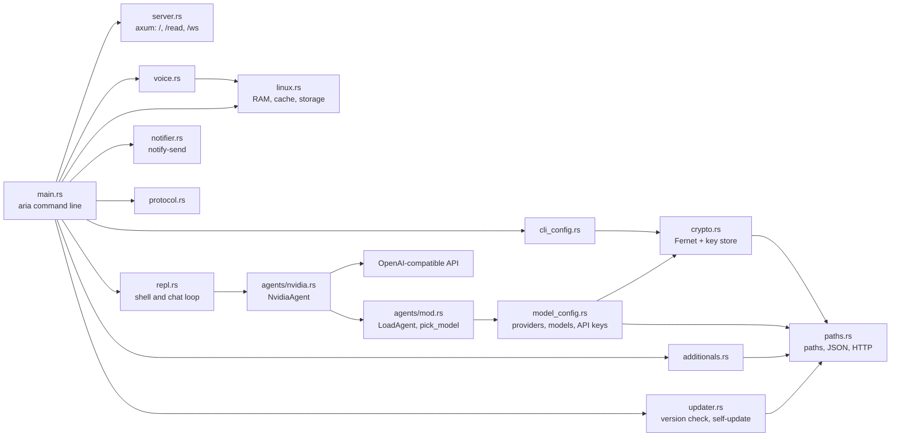
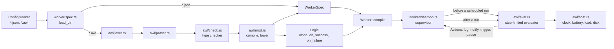

# A.R.I.A code graphs

These diagrams describe the Rust codebase (`src/`).

## Runtime architecture

## Workers and AWL

## Notes

- `config/path_config.json` and `config/config.json` are compiled into the binary.
  An installed `~/.A.R.I.A/config/config.json` takes precedence for version metadata.
- Every module has its own logger (`logger.rs`); most write to a file under
  `~/.config/A.R.I.A/Logs`. `aria -v` mirrors log lines to stderr.
- `agents::Agents` is a placeholder for planned features. Workers (`worker/`) are described in [workers.md](workers.md).
